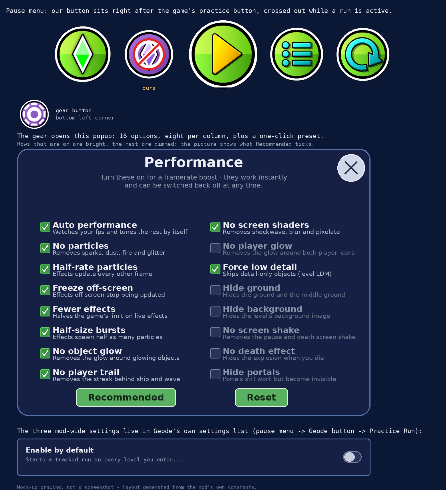

# Practice Run

A [Geode](https://geode-sdk.org/) mod for Geometry Dash that keeps count of the
deaths in your practice run, so a run finished without dying still counts as a
real completion.



The picture above is a mock-up of the mod's UI, not a screenshot: the buttons are
drawn at the size and position the mod really gives them, and the popup is copied
from the mod's own layout numbers. `preview-idle.png` is the same thing with the
mod switched off.

## What it does

A purple round button appears in the pause menu, in the row with the game's own
buttons, right after the practice button.

| What you do | What happens |
| --- | --- |
| Press it with no run going | Practice mode turns on and the level restarts from 0%. The mod starts counting your deaths |
| Finished with 0 deaths | The completion is saved as a normal completion: normal percentage, stars and coins, the usual Level Complete screen |
| Died at least once | You can keep respawning from your checkpoints, but reaching the end only counts as a practice completion |
| Press it again during a run | The mod switches off and the level returns to normal (non-practice) mode without restarting, so you keep your position, your attempt and your progress |

While a run is active the button carries the same red "no entry" mark the game's
own practice button uses, so you can see at a glance whether the mod is tracking.
There is also a small label in the corner with your death count, and an **Enable
by default** setting that starts a tracked run on every level you enter.

## Performance options

The smaller gear button in the bottom-left corner of the pause menu opens a popup
with 16 framerate options. All of them apply immediately, even in the middle of a
level, and all of them can be switched back off:

| Option | What it does |
| --- | --- |
| Auto performance | Measures the framerate and switches effects off by itself below 50 fps, and back on above 58. Never touches your own checkboxes |
| No particles | Removes sparks, dust, fire and glitter, and stops the effects instead of only hiding them |
| Half-rate particles | Effects update every other frame, with two frames' worth of time, so they look the same for half the simulation work |
| Half-size bursts | Every effect is built with half as many particles |
| Fewer effects | Halves the game's own limit on how many effects may exist at once |
| Freeze off-screen | Effects that have scrolled out of view stop being updated until they come back |
| No player trail | The streak behind the icon in ship, wave, ufo, ball and spider |
| No object glow | The glow layers and the glow of every object |
| No screen shaders | The 2.2 screen effects: shockwave, blur, pixelate, ... |
| No player glow | The glow sprite drawn around both icons |
| Force low detail | Detail-only objects are skipped, like the level's own LDM |
| No screen shake | The screen shake on pause and from shake triggers |
| Hide ground | The ground and the middle-ground layer |
| Hide background | The level's background image |
| No death effect | The explosion when you die |
| Hide portals | The portal sprites. They still work, you just cannot see them |

**Recommended** at the bottom of the popup switches on the ten options that save
the most work without hiding anything you need to see (particles, half-rate,
half-size bursts, fewer effects, freeze off-screen, trail, object glow, shaders,
low detail, auto performance). **Reset all** switches every option off again.

The options only change what is drawn and simulated, never the physics, so they
cannot change whether you pass a level.

## Settings

Geometry Dash -> Geode -> Mods -> Practice Run:

* **Show pause menu button** - hides both buttons.
* **Show run label** - hides the death counter.
* **Enable by default** - starts a tracked run on every level you enter.
* the 16 performance options listed above.

## Installing

Grab `practicerun.tracked-practice.geode` from the releases page and either use
Geode's "Install From File" button or copy it into

```
Geometry Dash/geode/mods
```

then restart the game. It needs Geode 5.10.1 or newer, on Windows, GD 2.2081.

## Building from source

Install the [Geode SDK](https://docs.geode-sdk.org/getting-started/sdk) and the
Geode CLI, then in this folder:

```bash
geode build
```

That leaves a `practicerun.tracked-practice.geode` next to the source, which
installs exactly like the released one.

## How it works

* **The button** calls `PlayLayer::togglePracticeMode(true)` - what the game's
  own practice button does - then restarts the level. Pressing it during a run
  instead clears `m_isPracticeMode` / `m_practiceMusicSync`, the two flags the
  game's button flips, but skips the restart.
* **Deaths** are counted in the `PlayLayer::destroyPlayer` hook, with the same
  guard the game uses (`!m_playerDied`, plus ignoring the anti-cheat spike), so
  one death counts once and not once per collision.
* **The 0-death completion** works because the game decides between a normal and
  a practice completion by reading `m_isPracticeMode` while it finishes the
  level. If the run had no deaths, the mod clears that flag just before calling
  the original `levelComplete()`, so the completion is processed as a normal one.
* **The button's place in the row** is found by looking for the game's own
  practice button inside the pause menu, since the row has no node id. The
  spacing between the existing buttons is measured rather than hard-coded, and
  our button is inserted with both halves of the row shifted outwards by half its
  width, which keeps the row centred. Buttons other mods have added to that row
  move along with it.
* **Enable by default** cannot restart the level from inside `PlayLayer::init`,
  so it is queued to the end of the frame with `geode::queueInMainThread`.
* **The performance options** mostly live in one hook: every particle effect in
  the game is advanced through `CCParticleSystem::update`, and that is where the
  mod decides whether an effect runs normally, runs with two frames' worth of
  time, is frozen because it is off screen, or is skipped entirely.

## Repository layout

| Path | What it is |
| --- | --- |
| `mod.json` | The mod's metadata: id, version, links and all settings |
| `CMakeLists.txt` | The build description of the mod |
| `src/PracticeRun.*` | The tracked run: state, death counting, completions |
| `src/PauseMenu.cpp` | The pause menu buttons and what they do |
| `src/Performance.*` | The performance options and the game hooks that apply them |
| `src/PerfSettings.*` | The performance popup |
| `src/main.cpp` | Entry point |
| `resources/` | The button, the active button and the gear |
| `logo.png` | The mod icon |
| `tools/make_icons.py` | Draws the icons above and the logo (Python + Pillow) |
| `.github/workflows/` | Builds the mod on GitHub |

## Known limits

* The death count belongs to the most recent run started with the button.
  Restarting the level or toggling practice mode by hand does not reset it -
  press the button again for a fresh run.
* Dying after switching the mod off does not count towards anything.
* Hiding the ground, the background or the portals changes how a level looks,
  which can make it genuinely harder to read.
* Auto performance reacts to a sustained low framerate, so a single stutter or a
  pause will not switch anything off.

## Links

* Discord: https://discord.gg/PDUu5ENwQu
* Source: https://github.com/ifeud/practice-run
